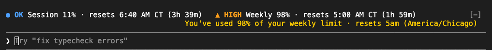

# Plan Usage

A [Claude Code mod](https://code.claude.com/docs/en/plugins/mods/overview) that keeps your Claude plan's limits in view and lets Claude check them itself.



- **A line above the prompt** with your session (5-hour) and weekly limits, how much of each you have used, and when each resets, in your time zone.
- **A `plan_usage` tool** Claude can call before long or unattended work, and a `/plan-usage` command for you. Neither one calls the model, so checking costs no tokens.
- **An optional pause** that stops a long-running session just before the session limit and continues it after the limit resets.

## Requirements

- Claude Code **2.1.289 or later**. This is the version it is tested on; mods are early access and the API moves between releases.
- A claude.ai **Pro or Max** plan. Claude Code reports plan limits only on a subscription; on an API key the line says there is no reading.

Tested on macOS. It uses no platform-specific code, but Linux and Windows are untested.

## Install

```sh
claude plugin marketplace add potterdigital/plan-usage-mod
claude plugin install plan-usage@potterdigital
```

Or from inside a session: `/plugin install plan-usage --marketplace potterdigital/plan-usage-mod`.

To try it without installing, clone the repository and start a session with `claude --plugin-dir ./plan-usage-mod`.

## What you see

| Line shows                               | Means                                              |
| ---------------------------------------- | -------------------------------------------------- |
| `● OK` in blue                           | Under the warning level (80% unless you change it) |
| `▲ HIGH` in orange                       | At or above the warning level                      |
| `■ LIMIT` in orange                      | At or past 100%                                    |
| `⏸ PAUSED at 96% · continues 4:12 AM CT` | The optional pause is holding the session          |
| `as of 2:31 AM CT`                       | The newest figures are more than 5 minutes old     |

Every level has its own icon and word as well as its color, so it reads the same for colorblind users.

When the terminal is narrower than 100 columns, the line shortens to the time left, as in `Session 9% · 3h 55m`. Anything other mods draw in the same place stays visible below this line.

## The `plan_usage` tool

Claude sees it as `mcp__plan-usage__plan_usage`. It takes no input and answers JSON:

```json
{
  "limits": [
    {
      "kind": "five_hour",
      "percentUsed": 8,
      "resetsAt": "2026-10-04T11:40:00.000Z",
      "label": "Session",
      "level": "ok",
      "resetsAtLocal": "6:40 AM CT",
      "resetsIn": "3h 57m"
    },
    {
      "kind": "seven_day",
      "percentUsed": 98,
      "resetsAt": "2026-10-04T10:00:00.000Z",
      "label": "Weekly",
      "level": "high",
      "resetsAtLocal": "5:00 AM CT",
      "resetsIn": "2h 17m"
    }
  ],
  "readAtLocal": "2:43 AM CT",
  "timeZone": "America/Chicago",
  "autoPause": { "isOn": false, "threshold": 95, "pause": null }
}
```

`kind`, `percentUsed` and `resetsAt` are exactly what Claude Code reports. Other kinds appear when your plan has them, such as `seven_day_opus`. `/plan-usage` prints the same JSON.

To have Claude check before big jobs, add a line like this to your `CLAUDE.md`: `Before starting long or unattended work, call plan_usage and stop if the weekly limit is above 90%.`

## Where the numbers come from

Claude Code reads your plan limits from each model reply; they are the figures its status line receives. This mod takes them from there (`$.session.usage()` and the `session.measure` event) and makes no network requests of its own.

- **While Claude works**, the line updates with every reply.
- **While a session is idle**, it checks once a minute for a newer reading another of your open sessions stored (the same login, through `$.store`). That check is a local file read.
- **When every session is idle**, nothing is new to read, so the line keeps the last figures and shows how old they are.

The figures are Claude Code's, so they are as current as its last reply. A limit can move from usage elsewhere, such as claude.ai in a browser, before the next reply shows it.

## The optional pause

Off by default. When it is on and the session limit reaches the threshold (95% unless you change it) during a turn:

1. Tool calls that are already running finish. New ones are refused with a message telling Claude to stop.
2. The turn ends.
3. Two minutes after the session limit resets, the mod sends the session a prompt to continue: `Plan usage reset; resume where you left off from the files on disk.` Claude reads it with a note that this mod sent it, not you.

If the turn finishes on its own before anything was refused, nothing is continued later.

Keep the session open: closing it, `/clear`, `/resume` and `/branch` cancel a waiting continue. The pause watches the session limit only. If the weekly limit is what runs out, the continuing prompt meets that limit instead.

**How this differs from Claude Code's built-in waiting.** Claude Code already waits and continues on its own when a usage limit stops a session ([`autoContinueAtUsageLimit`](https://code.claude.com/docs/en/interactive-mode#wait-for-a-usage-limit-to-reset), on by default). That starts once the limit has been hit, wherever the work was. This pause starts a little earlier, at a threshold you pick, so the turn ends between tool calls rather than partway through one, and the session keeps some headroom for you.

## Settings

Set these in `/config`, where each one is a row, or in `settings.json`:

```json
{
  "pluginConfigs": {
    "plan-usage@potterdigital": {
      "options": { "auto_pause": true, "pause_threshold": 90 }
    }
  }
}
```

With `--plugin-dir`, the key is `plan-usage@inline`.

| Setting           | Default   | What it does                                                                                                                                                         |
| ----------------- | --------- | -------------------------------------------------------------------------------------------------------------------------------------------------------------------- |
| `warn_at`         | `80`      | Percent at which the line turns orange and reads HIGH                                                                                                                |
| `time_zone`       | empty     | IANA time zone for reset times, such as `America/New_York`. Empty uses your computer's. An invalid name falls back to your computer's and says so in the transcript. |
| `auto_pause`      | `false`   | Turns the pause on                                                                                                                                                   |
| `pause_threshold` | `95`      | Session-limit percent that starts the pause                                                                                                                          |
| `resume_prompt`   | see above | What the session is sent when it continues                                                                                                                           |

## What it can access

`claude plugin validate .` lists everything the mod hooks and calls. In short:

- **Reads:** the plan figures Claude Code already has, and the `CLAUDE_CONFIG_DIR` environment variable, which keeps readings from different Claude profiles apart.
- **Writes:** the last reading, to this mod's own file in Claude Code's plugin store (`~/.claude/plugins/store/`).
- **Acts:** when the pause is on, it refuses tool calls, ends a turn, and sends one prompt. Nothing else.
- **Never:** network requests, other files, other environment variables, model calls.

## Development

```sh
claude plugin test .               # 11 tests, under a second
claude plugin validate --strict .  # what the engine will load, warnings as errors
prettier --check .
```

To type-check, load the mod once (`claude --plugin-dir .`) so Claude Code writes the type declarations for your version into `.claude-plugin/types/`, then run `npx -p typescript tsc -p .`. CI runs the first three; it cannot type-check, because Anthropic's published copy of the declarations predates APIs this mod uses.

See [CONTRIBUTING.md](CONTRIBUTING.md) and [SECURITY.md](SECURITY.md).

## License

[MIT](LICENSE). Not affiliated with Anthropic. Claude and Claude Code are trademarks of Anthropic.
